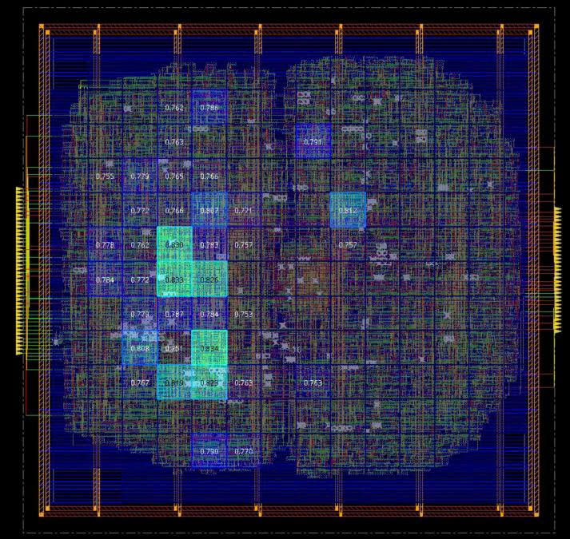
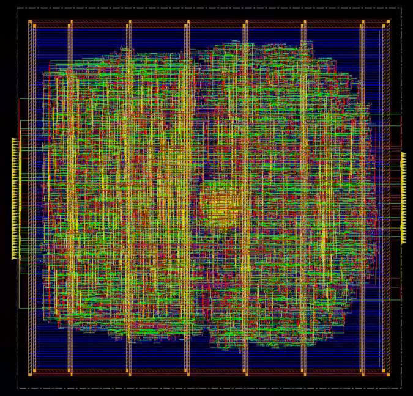
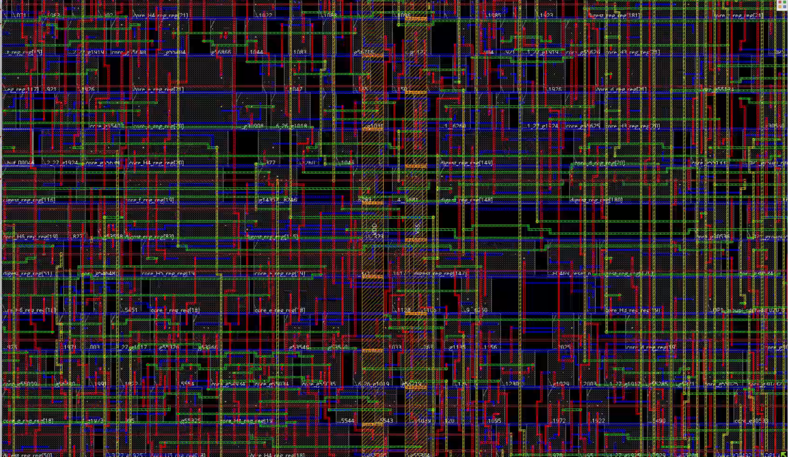

# SHA-256 ASIC Physical Design Gallery

Technology: GPDK045 45 nm.

EDA tool: Cadence Innovus 25.12.

These screenshots document the physical implementation of the SHA-256 ASIC.

## 01 - Power Rings and Stripes

Power-grid geometry showing power rings and stripes.

## 02 - Special Power Routing

Special-routing view illustrating power connectivity.

## 03 - Standard-Cell Placement

Standard-cell placement with an Innovus analysis overlay.

## 04 - Clock Distribution

Clock-distribution routing visualization.

## 05 - Clock Tree Debugger

Clock-tree topology displayed in the Innovus Clock Tree Debugger.

## 06 - Post-CTS Layout

Physical implementation view at the CTS stage.

## 07 - Final Routed Layout

.jpg)

Full-chip layout after global and detailed signal routing.

## 08 - Detailed Routing Zoom

Close-up of multi-layer routing across standard-cell regions.

## Engineering Notes

The screenshots were captured during physical implementation, before the separate vectorless power-report extraction.

Screenshots provide visual implementation evidence, not independent DRC/LVS signoff.

See [EDA Reports](../reports/README.md) for the numerical implementation and power results.
